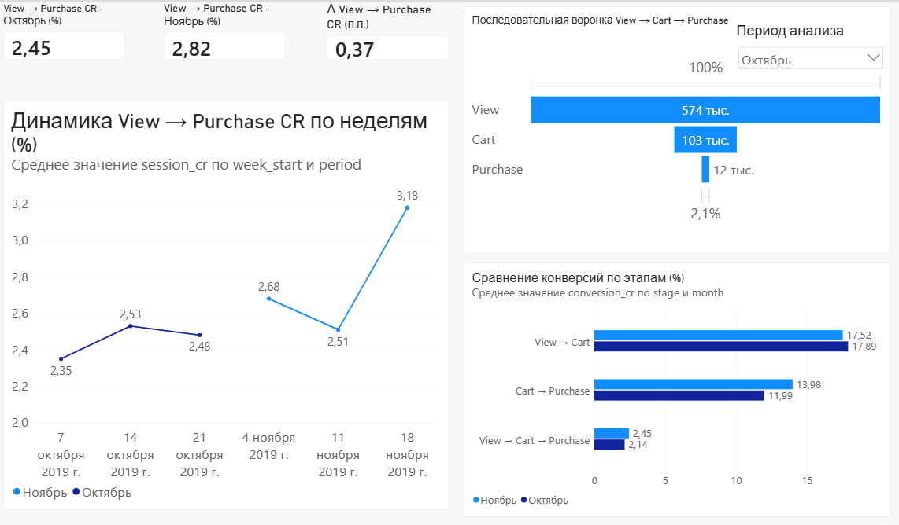
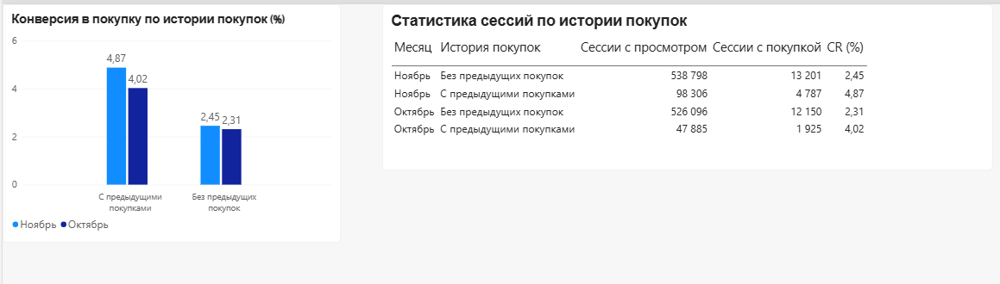

# E-commerce Product Analytics: Conversion Funnel & Growth Opportunities

**Portfolio project | Product Analyst / Data Analyst**

Анализ пользовательских событий интернет-магазина косметики: конверсия в покупку, последовательная воронка, недельная динамика и сегментация по истории покупок.

**Стек:** PostgreSQL 17, SQL, Python, Pandas, Jupyter, Docker Compose, Power BI.

**Датасет:** [eCommerce Events History in Cosmetics Shop — Kaggle](https://www.kaggle.com/datasets/mkechinov/ecommerce-events-history-in-cosmetics-shop)

## 1. Business Objective

**Цель:** исследовать конверсию из просмотра товара в покупку, выявить проблемные этапы воронки и сформулировать гипотезы для дальнейшего продуктового исследования.

Исследовательские вопросы:
- Как меняется конверсия между октябрём и ноябрём?
- На каком этапе воронки наблюдаются основные различия?
- Как связана история предыдущих покупок с конверсией?
- Насколько результаты зависят от способа определения сессии?

## 2. Key Results

Анализируются две сопоставимые трёхнедельные выборки:

- **Октябрь:** 07.10.2019–27.10.2019 включительно.
- **Ноябрь:** 04.11.2019–24.11.2019 включительно.

Это не показатели за полные календарные месяцы.

| Metric | October | November |
|---|---:|---:|
| View sessions | 573 981 | 637 104 |
| View → Purchase CR | 2.45% | 2.82% |
| View → Cart CR | 17.89% | 17.52% |
| Cart → Purchase CR | 11.99% | 13.98% |
| Full Funnel CR | 2.14% | 2.45% |

### Main findings

1. View → Purchase CR в ноябре выше на **0,37 процентного пункта**.
2. View → Cart CR немного ниже: 17,89% → 17,52%.
3. Cart → Purchase CR выше: 11,99% → 13,98%.
4. Сессии пользователей с наблюдаемой историей покупок имеют более высокую конверсию, чем сессии без такой истории.
5. Направление различия между месяцами сохраняется при порогах неактивности 15, 30 и 60 минут.

Эти результаты являются наблюдательными и не доказывают причинно-следственную связь.

**Подробный аналитический отчёт:** [analysis_summary.md](reports/analysis_summary.md).

## 3. Metric Definitions

### Primary KPI: View → Purchase CR

Доля сессий с просмотром товара, в которых после первого просмотра наблюдалась покупка.

`CR = converted_view_sessions / all_view_sessions × 100%`

В этой метрике наличие события `cart` необязательно.

### Sequential Funnel

Последовательность событий внутри одной аналитической сессии:

`View → Cart → Purchase`

Для переходов требуется строгое соблюдение временного порядка событий.

Полная конверсия по воронке может отличаться от основного KPI: в данных встречаются покупки без зафиксированного добавления в корзину после просмотра.

### Session Definition

Аналитические сессии строятся по паре `(user_id, user_session)`.

При перерыве между событиями более **30 минут** начинается новая аналитическая сессия.

Сессии без `user_session` не участвуют в финальном сессионном анализе.

## 4. Project Structure

```text
ecommerce-conversion-analysis/
├── compose.yaml
├── .env.example
├── requirements.txt
├── data/
│   ├── raw/
│   └── processed/
├── notebooks/
│   ├── 01_eda.ipynb
│   └── 02_product_analysis.ipynb
├── sql/
│   ├── schema/
│   │   ├── 01_create_events.sql
│   │   └── 02_build_sessions.sql
│   └── analysis/
├── reports/
│   ├── analysis_summary.md
│   └── ecommerce_dashboard.pbix
└── README.md
```

Исходные CSV в Git не включаются. Агрегированные CSV в `data/processed/` включены для воспроизведения визуализаций.

## 5. How to Run

Инструкция рассчитана на Windows, WSL Ubuntu и Docker Desktop.

### Step 1. Start PostgreSQL

Из корня проекта:

```bash
cp .env.example .env
```

Задайте собственный пароль в `.env` перед первым запуском.

```bash
docker compose up -d
docker compose ps
```

Если локальная база уже существует, не перезаписывайте рабочий `.env` и не удаляйте Docker volume.

### Step 2. Download Data

Скачайте с Kaggle:

- `2019-Oct.csv`
- `2019-Nov.csv`

Поместите файлы в `data/raw/`.

### Step 3. Create Raw Table

```bash
docker compose exec -T db psql -v ON_ERROR_STOP=1 \
  -U analyst -d ecommerce \
  < sql/schema/01_create_events.sql
```

### Step 4. Import CSV

Выполните один раз на пустой таблице `raw.events`:

```bash
for file in data/raw/2019-Oct.csv data/raw/2019-Nov.csv; do
  docker compose exec -T db psql -v ON_ERROR_STOP=1 \
    -U analyst -d ecommerce \
    -c "\copy raw.events (event_time, event_type, product_id, category_id, category_code, brand, price, user_id, user_session) FROM STDIN WITH (FORMAT csv, HEADER true)" \
    < "$file"
done
```

Ожидаемое количество событий: **8 738 120**.

Повторная загрузка без очистки таблицы приведёт к дублированию данных.

### Step 5. Build Analytical Sessions

```bash
docker compose exec -T db psql -v ON_ERROR_STOP=1 \
  -U analyst -d ecommerce \
  < sql/schema/02_build_sessions.sql
```

Ожидаемые результаты:
- `analytics.session_events`: 8 736 670 записей.
- `analytics.sessions`: 1 925 862 сессии.

### Step 6. Run SQL Analysis

Основные файлы:

| File | Purpose |
|---|---|
| `14_sessionized_conversion.sql` | Primary KPI |
| `15_sessionized_funnel.sql` | Sequential funnel |
| `16_sessionized_weekly.sql` | Weekly conversion |
| `17_sessionized_segments.sql` | Purchase-history segments |
| `18_funnel_discrepancy.sql` | KPI discrepancy analysis |
| `19_session_sensitivity.sql` | Session threshold sensitivity |
| `20_november_quality.sql` | November data quality |

Пример запуска:

```bash
docker compose exec -T db psql -v ON_ERROR_STOP=1 \
  -U analyst -d ecommerce \
  < sql/analysis/14_sessionized_conversion.sql
```

Файлы `01`–`13` содержат предварительные исследовательские расчёты.

### Step 7. Run Jupyter

Из корня проекта:

```bash
python3 -m venv .venv
source .venv/bin/activate
pip install -r requirements.txt
cd notebooks
jupyter lab
```

Выполните `02_product_analysis.ipynb`.

Ноутбук обращается к локальному PostgreSQL и экспортирует четыре CSV в `data/processed/`.

### Step 8. Open Power BI

Откройте файл:

`reports/ecommerce_dashboard.pbix`

Дашборд содержит две страницы:

- **Conversion Overview** — KPI, недельная динамика и воронка.
- **Customer Segments** — конверсия по истории покупок.

Для обновления данных откройте Power Query →
«Управление параметрами» → `DataFolder` и укажите
абсолютный путь к локальной папке `data/processed/`,
включая завершающий разделитель `\`.
После этого нажмите «Закрыть и применить».


## Dashboard Preview

### Conversion Overview



### Customer Segments




## 6. Data Quality and Limitations

- В анализ включены два выбранных трёхнедельных интервала, а не полные месяцы.
- Поле `category_code` отсутствует примерно в 98% событий.
- Поле `brand` содержит значительное количество пропусков.
- Имеются события покупки с некорректными отрицательными ценами.
- Данные о предыдущих покупках ограничены доступной историей.
- Воронка отслеживает события в пределах сессии, не обязательно одного товара.
- Одинаковые временные метки не позволяют установить точный порядок событий.
- Значение Session CR зависит от выбранного порога неактивности.
- По наблюдательным данным нельзя установить причину изменения конверсии.

## 7. Product Hypotheses

На основе результатов сформулированы гипотезы для дальнейшей проверки:

1. **Checkout friction:** различия на этапе Cart → Purchase могут быть связаны с изменением пользовательского поведения или условий оформления заказа.
2. **Returning purchasers:** пользователи с наблюдаемыми предыдущими покупками могут иметь иной уровень намерения совершить покупку.
3. **Period effects:** изменение конверсии может зависеть от состава трафика, ассортимента, цен и календарных факторов.

Для проверки потребуются дополнительные данные, сегментация или контролируемые эксперименты.

Подробные гипотезы и ограничения приведены в [analysis_summary.md](reports/analysis_summary.md).

## 8. Data Source

Kaggle: [eCommerce Events History in Cosmetics Shop](https://www.kaggle.com/datasets/mkechinov/ecommerce-events-history-in-cosmetics-shop).

Исходные данные не включены в репозиторий. Файл `.env` с локальными параметрами подключения также не публикуется.
